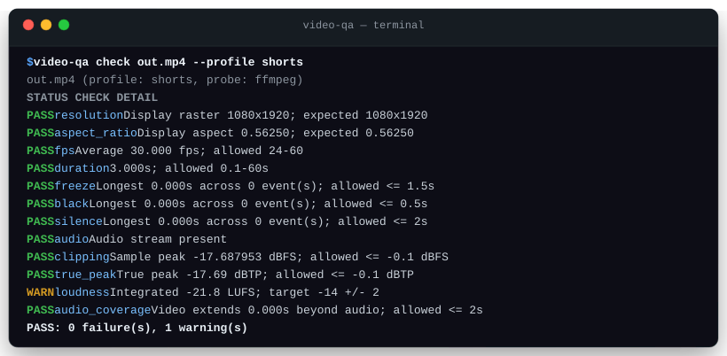

# video-qa

[](https://github.com/YusufBeratZengin/video-qa/actions/workflows/ci.yml)
[](https://pypi.org/project/video-qa/)
[](https://www.python.org/downloads/)
[](LICENSE)

Local quality gates for rendered videos using FFmpeg.

Detect frozen frames, black segments, missing or silent audio, peaks near clipping,
loudness drift, and unexpected resolution, frame rate, or duration before publishing
or as an automated CI gate. Ideal after Remotion renders or FFmpeg automation scripts.

[Türkçe](README.tr.md) · [Contributing](CONTRIBUTING.md) · [Changelog](CHANGELOG.md)



## Why video-qa?

* **100% Local & Zero Cloud Costs**: Runs entirely on your machine or CI runner using FFmpeg. No video uploads, no third-party APIs, and zero subscription fees.
* **Automated Multi-Pass Defect Detection**: Concurrently scans for frozen frames, black screens, silent dropouts, clipping audio peaks, loudness drift, and audio/video desync before your viewers notice.
* **Built for CI/CD & Remotion Pipelines**: Native JUnit XML, strict JSON output, standard exit codes, and presets for Shorts, Reels, and TikTok ready to plug into GitHub Actions.

## Quick start

Requires Python 3.10+ and FFmpeg.

```console
# 1. Install video-qa (add '.[ffmpeg]' if ffmpeg is not already in your PATH)
python -m pip install .

# 2. Run a quality gate against your rendered video
video-qa check out.mp4 --profile shorts
```

If `ffprobe` is present on PATH or passed via `--ffprobe`, container metadata is read from ffprobe JSON. If `ffprobe` is missing, `video-qa` automatically falls back to parsing `ffmpeg -hide_banner -i` output, keeping the tool fully functional without extra dependencies.

## Usage examples

```console
# Inspect built-in presets and threshold configurations
video-qa --list-profiles

# Check with custom threshold overrides
video-qa check out.mp4 --profile shorts --max-freeze 1.5 --target-lufs -14
video-qa check out.mp4 --profile reels --max-duration 120 --max-silence 1

# Export machine-readable JSON or JUnit XML reports
video-qa check out.mp4 --profile tiktok --format json --output report.json
video-qa check out.mp4 --profile examples/custom.toml --format junit --output junit.xml

# Fail CI builds on any warnings (such as loudness deviations)
video-qa check out.mp4 --fail-on-warn

# Custom timeouts and binary paths
video-qa check out.mp4 --ffmpeg /path/to/ffmpeg --ffprobe /path/to/ffprobe --timeout 600
```

### CLI Options

* `--profile`: Profile preset (`shorts`, `reels`, `tiktok`) or path to a custom `.toml`/`.json` file.
* `--list-profiles`: Print all built-in presets and their default thresholds, then exit.
* `--fail-on-warn`: Treat warnings as failures (exit code 1).
* `--format`: Output format: `human` (default table), `json` (strict schema), or `junit` (JUnit XML).
* `--output`: Write report directly to a file instead of stdout.
* `--timeout`: Subprocess timeout in seconds per pass (default: 300).
* `--ffmpeg` / `--ffprobe`: Custom executable paths.

| Exit code | Meaning |
| --- | --- |
| 0 | All required checks passed; warnings may be present (unless `--fail-on-warn` is used) |
| 1 | Quality failure, decoding/tool/measurement error, `--fail-on-warn` with warnings, or report write failure |
| 2 | Invalid arguments or profile configuration |

### CI/CD Integration (GitHub Actions)

Run `video-qa` as an automated gate in your CI pipeline after rendering videos with Remotion or FFmpeg. See [examples/github-workflow.yml](examples/github-workflow.yml) for a complete reusable workflow.

```yaml
- name: Run video-qa quality gate
  run: video-qa check out.mp4 --profile shorts --format junit --output junit.xml

- name: Upload JUnit report
  if: always()
  uses: actions/upload-artifact@v4
  with:
    name: video-qa-junit-report
    path: junit.xml
```

### Sample Reports

#### Human report (`--format human`)

```text
out.mp4 (profile: shorts, probe: ffmpeg)
STATUS  CHECK           DETAIL
PASS    resolution      Display raster 1080x1920; expected 1080x1920
PASS    aspect_ratio    Display aspect 0.56250; expected 0.56250
PASS    fps             Average 30.000 fps; allowed 24-60
PASS    duration        3.000s; allowed 0.1-60s
PASS    freeze          Longest 0.000s across 0 event(s); allowed <= 1.5s
PASS    black           Longest 0.000s across 0 event(s); allowed <= 0.5s
PASS    silence         Longest 0.000s across 0 event(s); allowed <= 2s
PASS    audio           Audio stream present
PASS    clipping        Sample peak -17.687953 dBFS; allowed <= -0.1 dBFS
PASS    true_peak       True peak -17.69 dBTP; allowed <= -0.1 dBTP
WARN    loudness        Integrated -21.8 LUFS; target -14 +/- 2
PASS    audio_coverage  Video extends 0.000s beyond audio; allowed <= 2s
PASS: 0 failure(s), 1 warning(s)
```

#### JUnit XML report (`--format junit`)

```xml
<?xml version='1.0' encoding='utf-8'?>
<testsuite name="video-qa" tests="12" failures="0" errors="0" skipped="0">
  <properties>
    <property name="input" value="out.mp4" />
    <property name="profile" value="shorts" />
    <property name="probe_source" value="ffmpeg" />
    <property name="warnings" value="1" />
  </properties>
  <testcase classname="video_qa" name="resolution" />
  <testcase classname="video_qa" name="aspect_ratio" />
  <testcase classname="video_qa" name="fps" />
  <testcase classname="video_qa" name="duration" />
  <testcase classname="video_qa" name="freeze" />
  <testcase classname="video_qa" name="black" />
  <testcase classname="video_qa" name="silence" />
  <testcase classname="video_qa" name="audio" />
  <testcase classname="video_qa" name="clipping" />
  <testcase classname="video_qa" name="true_peak" />
  <testcase classname="video_qa" name="loudness">
    <system-out>WARNING: Integrated -21.8 LUFS; target -14 +/- 2</system-out>
  </testcase>
  <testcase classname="video_qa" name="audio_coverage" />
</testsuite>
```

Full generated samples: [examples/report.json](examples/report.json) and [examples/junit.xml](examples/junit.xml).

## Configuration

Built-in presets provide baseline thresholds for common short-form platforms:

| Preset | Display raster | Display aspect | Average fps | Duration |
| --- | --- | --- | --- | --- |
| `shorts` | 1080×1920 | 9:16 | 24–60 | 0.1–60 seconds |
| `reels` | 1080×1920 | 9:16 | 24–60 | 0.1–90 seconds |
| `tiktok` | 1080×1920 | 9:16 | 24–60 | 0.1–180 seconds |

### Default Thresholds

| Setting | Default | Result when exceeded |
| --- | --- | --- |
| `max_freeze` | 1.5 seconds | Failure |
| `max_black` | 0.5 seconds | Failure |
| `max_silence` | 2 seconds | Failure |
| `target_lufs` / `lufs_tolerance` | −14 / ±2 LUFS | Warning |
| `max_peak_dbfs` | −0.1 dBFS sample peak and −0.1 dBTP true peak | Failure |
| `require_audio` | `true` | Failure if no audio stream |

### Custom Profiles (TOML & JSON)

Custom configuration files inherit from built-in presets using `extends` (defaults to `shorts`).

```toml
extends = "shorts"
name = "my-render-gate"
max_duration = 75
max_freeze = 0.5
target_lufs = -14
lufs_tolerance = 2
loudness_severity = "fail"
```

Configurable keys: `width`, `height`, `aspect_ratio`, `aspect_tolerance`, `min_fps`, `max_fps`, `min_duration`, `max_duration`, `max_freeze`, `max_black`, `max_silence`, `silence_db` (−50 dB), `freeze_noise_db` (−60 dB), `black_pixel_threshold` (0.1), `black_picture_ratio` (0.98), `max_peak_dbfs`, `require_audio`, and `loudness_severity` (`warn` or `fail`). Examples: [TOML](examples/custom.toml) and [JSON](examples/custom.json).

## FAQ & Limitations

* **How does decoding work?**
  Metadata is probed via `ffprobe` (or `ffmpeg -i` fallback). Analysis runs in two concurrent passes via a thread pool: `freezedetect`/`blackdetect` on the video stream, and `silencedetect`/`astats`/`loudnorm` on the audio stream. On modern multi-core hardware, 60 seconds of video processes in ~2.7 seconds (~22× realtime).
* **Can still title cards or artistic pauses trigger defects?**
  Yes. Intentional pauses, static slide intros, or audio fades can trip freeze or silence limits if they exceed configured thresholds. Tune `--max-freeze`, `--max-black`, or `--max-silence` to fit your content style.
* **How are audio peaks and loudness measured?**
  Sample peak and true peak are measured on the original audio prior to loudness calculation. The tool measures EBU R128 integrated loudness (LUFS). Digital silence yields `-inf` LUFS (serialized as `"-inf"` string in JSON).
* **What is out of scope?**
  `video-qa` does not perform speech-to-text recognition, perceptual subjective video scoring (such as VMAF), codec compatibility policy checks, or platform API upload validation.
* **Is my media uploaded anywhere?**
  No. All analysis runs entirely on your local machine or CI runner. Network protocols are disabled in FFmpeg calls. Diagnostic reports contain local file paths and decoder messages; review them before sharing.

## Contributing

Contributions are welcome! Please read [CONTRIBUTING.md](CONTRIBUTING.md) and our [Code of Conduct](CODE_OF_CONDUCT.md).

### Local Development Setup

```console
# Clone and install in editable mode with development dependencies
git clone https://github.com/YusufBeratZengin/video-qa.git
cd video-qa
python -m pip install -e ".[dev]"

# Run tests and coverage
python -m pytest

# Run linting and formatting checks
python -m ruff check src tests scripts
python -m ruff format --check src tests scripts

# Run static type checking
python -m mypy

# Build distributions
python -m build
```

## License

MIT. Copyright (c) 2026 Yusuf Berat Zengin. See [LICENSE](LICENSE) for details.
